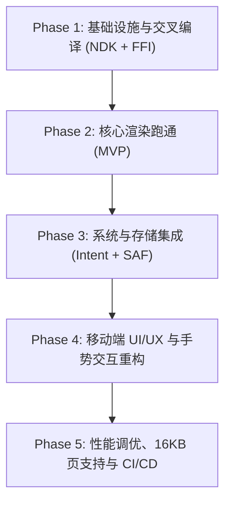

# RFC: SuperGoodViewer Android 移动端移植与架构设计

- **状态**: 草案 (Draft) / 待评审
- **目标平台**: Android 8.0+ (API Level 26+), 优先支持 Android 10+ (API Level 29+) 与 Android 15 (16KB 页对齐规范)
- **支持架构**: `arm64-v8a` (主流真机), `x86_64` (模拟器与 ChromeOS), `armeabi-v7a` (向下兼容)
- **文档编号**: RFC-2026-001-ANDROID

---

## 1. 背景与目标 (Background & Objectives)

### 1.1 项目背景
SuperGoodViewer（超好读）作为一款以**“只读专注、出版级排版、零 WebView、本地 Google PDFium 矢量光栅化”**为核心特性的 Markdown 阅读器，在桌面端（macOS、Windows、Linux）已实现了极高的一致性、毫秒级响应以及无损 PDF 原生导出能力。

随着用户在移动办公、平板阅读、电子书包、微信/邮件文档快速查看等场景需求的增加，推出 Android 移动端版本成为自然的演进方向。

### 1.2 核心设计原则延续
在 Android 端的移植中，必须严格恪守以下核心产品与架构哲学：
1. **纯原生、零 WebView 架构不妥协**：严禁退化为移动端常见的 WebView/HTML 渲染方案；坚持保持 `Markdown -> Rust Typst 内存编译 -> PDF 二进制流 -> Google PDFium (pdfrx) 矢量光栅化` 的纯本地确定性流水线。
2. **只读专注，极致阅读**：不提供富文本与复杂输入编辑，只为移动端提供最极致的排版渲染、无缝长卷轴滚动、大纲速览与平滑缩放。
3. **内存克制与即用即走**：针对移动端低内存杀后台（LMK）与电池续航敏感特性，保持 Rust 核心的零拷贝传输与按需内存映射。
4. **双形态自适应 (Responsive Form Factor)**：兼顾**手机竖屏单手阅读**与**平板/折叠屏横屏多栏阅读**。

---

## 2. 移动端 vs 桌面端差异与技术挑战 (Desktop vs Mobile Gap Analysis)

| 维度 | 桌面端现状 (Desktop) | Android 移动端要求 (Android) | 改造应对策略 |
| :--- | :--- | :--- | :--- |
| **底层二进制** | `.dylib` / `.dll` / `.so` 放置于 App Bundle 或同级目录 | `.so` 需打包进 APK 的 `lib/<abi>/`，且需满足 Android 15 的 16KB 页对齐 | 使用 `cargo-ndk` 交叉编译，传递 `-C link-arg=-Wl,-z,max-page-size=16384` |
| **文件系统访问** | 拥有绝对路径读写权限 (`/Users/...`, `C:\...`) | Android 10+ Scoped Storage 分区存储，外部文件以 `content://` URI 提供 | 建立 SAF 桥接层，将外部 Content 流拉取至沙盒临时目录供 Rust 编译 |
| **应用关联打开** | 依赖 CLI (`sgv`) 或系统文件右键关联 | 依赖 Android `Intent Filter` 响应微信、文件管理器等应用的“用其他应用打开” | 在 `AndroidManifest.xml` 中配置 `.md`/`.markdown`/`.pdf` 的 `VIEW` 意图监听 |
| **存储路径解析** | 读取 `HOME` / `APPDATA` 环境变量构建配置与缓存路径 | 移动端无此类环境变量，直接访问导致 `null` 崩溃 | 全面迁移至 `path_provider` 的 `getApplicationSupportDirectory()` |
| **交互与屏幕形态** | 鼠标滚轮/悬停、键盘快捷键（`Cmd+F`, `Cmd+,`）、大屏幕固定侧边栏 | 触摸屏、手势捏合缩放、屏幕窄长、刘海屏/挖孔屏/手势条 | 抽屉式侧边栏 (Drawer)、单击呼出沉浸式顶/底控制栏、`SafeArea` 适配 |
| **桌面独占机制** | macOS 交通灯占位、窗口拖拽区、本地 IPC 服务、桌面自动更新 | 移动端无窗口概念，无 CLI，更新走应用商店或 APK 下载 | 引入平台条件解耦，移动端禁用 IPC 与桌面自更新服务 |

---

## 3. 系统架构设计 (System Architecture)

```
┌─────────────────────────────────────────────────────────────────────────┐
│                     Android UI Shell (Flutter Mobile)                   │
│                                                                         │
│  ┌───────────────────────┐  ┌─────────────────┐  ┌───────────────────┐  │
│  │ 沉浸式阅读 AppBar     │  │  手势与视口容器 │  │  抽屉式大纲目录   │  │
│  │ (单击呼出/自动隐退)   │  │  (双击/双指缩放)│  │  (Modal / Drawer) │  │
│  └───────────────────────┘  └─────────────────┘  └───────────────────┘  │
│  ┌───────────────────────────────────────────────────────────────────┐  │
│  │              PDF 渲染核心: pdfrx (Google PDFium for Android)       │  │
│  │              - 硬件加速 Canvas 光栅化                             │  │
│  │              - 动态垂直视口裁剪与瓦片预加载                       │  │
│  └───────────────────────────────────────────────────────────────────┘  │
└────────────────────────────────────┬────────────────────────────────────┘
                                     │ C-ABI (dart:ffi)
                                     │ libsogood_core.so
                                     ▼
┌─────────────────────────────────────────────────────────────────────────┐
│               Rust Native Core (sogood_core compiled for Android)       │
│                                                                         │
│  1. Markdown & AST Transpiler (pulldown-cmark + mitex + mermaid-rs)     │
│  2. GlobalFontStore (扫描 /system/fonts/ + 载入 typst-assets 内置字体)  │
│  3. 内存编译器 (typst + typst-pdf)                                      │
│     └── 编译生成 PDF 内存字节流 (*mut SogoodBuffer)                     │
└─────────────────────────────────────────────────────────────────────────┘
```

---

## 4. 详细模块设计与实现方案 (Detailed Module Specifications)

### 4.1 Rust Native 核心交叉编译 (Rust Cross-Compilation)

#### 4.1.1 目标平台与工具链
使用 `cargo-ndk` 作为官方推荐的构建工具，与 Android NDK r26+ 配合：
- **Target 架构映射**:
  - `aarch64-linux-android` $\to$ `jniLibs/arm64-v8a/libsogood_core.so`
  - `x86_64-linux-android` $\to$ `jniLibs/x86_64/libsogood_core.so`
  - `armv7-linux-androideabi` $\to$ `jniLibs/armeabi-v7a/libsogood_core.so`

#### 4.1.2 Android 15 16KB 内存页对齐支持
Google Play 强制要求自 Android 15 起所有本地动态库必须支持 16KB 页大小。在 Rust 构建 flags 中注入：
```toml
# .cargo/config.toml (针对 Android 目标)
[target.aarch64-linux-android]
rustflags = ["-C", "link-arg=-Wl,-z,max-page-size=16384"]

[target.x86_64-linux-android]
rustflags = ["-C", "link-arg=-Wl,-z,max-page-size=16384"]
```

#### 4.1.3 字体发现与回退链 (`GlobalFontStore`)
- Android 系统字体统一存储于 `/system/fonts/`。
- `fontdb::Database::load_system_fonts()` 在 Android 下会原生枚举 `/system/fonts` 下所有字体（如 `Roboto-Regular.ttf`, `NotoSansSC-VF.otf`, `NotoColorEmoji.ttf` 等）。
- 为保证排版确定性，`typst-assets` 自带的 17 款出版级字体（如 New Computer Modern、DejaVu 等）依然静态打包进 `.so`，无需依赖任何网络下载。
- 中文默认回退字体优先绑定为 Android 系统级思源黑体（`Noto Sans CJK SC` / `Noto Sans SC`）。

---

### 4.2 FFI 动态库载入层 (`native_engine.dart`)

在 Android 系统中，打包在 APK 内的动态库会被解压至应用的专用原生库目录中（如 `/data/app/.../lib/arm64/`）。Android 动态链接器（linker）已将其注册在搜索路径中。

修改 `ui/lib/bridge/native_engine.dart`：
```dart
static String _resolveLibraryPath() {
  if (Platform.isAndroid) {
    // Android 下直接通过库名由系统 Linker 自动寻址
    return 'libsogood_core.so';
  } else if (Platform.isMacOS) {
    return 'libsogood_core.dylib';
  } else if (Platform.isWindows) {
    return 'sogood_core.dll';
  } else {
    return 'libsogood_core.so';
  }
}
```

---

### 4.3 文件系统与文档读取 (Storage & Intent Management)

#### 4.3.1 外部应用关联打开 (Intent Filter)
在 `ui/android/app/src/main/AndroidManifest.xml` 中配置：
```xml
<activity
    android:name=".MainActivity"
    android:exported="true"
    android:launchMode="singleTop">
    
    <intent-filter>
        <action android:name="android.intent.action.MAIN"/>
        <category android:name="android.intent.category.LAUNCHER"/>
    </intent-filter>

    <!-- 支持打开 Markdown 文档 -->
    <intent-filter>
        <action android:name="android.intent.action.VIEW" />
        <category android:name="android.intent.category.DEFAULT" />
        <category android:name="android.intent.category.BROWSABLE" />
        <data android:scheme="file" />
        <data android:scheme="content" />
        <data android:mimeType="text/plain" />
        <data android:mimeType="text/markdown" />
        <data android:mimeType="text/x-markdown" />
        <data android:pathPattern=".*\\.md" />
        <data android:pathPattern=".*\\.markdown" />
    </intent-filter>

    <!-- 支持打开原生 PDF 文档 -->
    <intent-filter>
        <action android:name="android.intent.action.VIEW" />
        <category android:name="android.intent.category.DEFAULT" />
        <category android:name="android.intent.category.BROWSABLE" />
        <data android:scheme="file" />
        <data android:scheme="content" />
        <data android:mimeType="application/pdf" />
        <data android:pathPattern=".*\\.pdf" />
    </intent-filter>
</activity>
```

#### 4.3.2 Content URI 沙盒中转流
当用户通过微信/QQ/文件管理器点击“用超好读打开”时，系统传递的是 `content://...` 形式的虚拟 URI。Rust 底层无法直接通过标准 C 库 `fopen` 打开该 URI。
- **解决方案**：
  1. Flutter 启动或 `onNewIntent` 监听到传入的 URI；
  2. 若为 `content://`，通过平台通道或 Dart `File` 读取二进制流；
  3. 将文件缓存至应用沙盒缓存目录：`<app_cache>/inbox/<hash>_<original_name>.md`；
  4. 将沙盒内的确定性绝对路径传给 `ReaderController.openFile(path)` 执行 Rust 编译渲染。

#### 4.3.3 路径服务重构 (`PreferencesService` & `DocumentCacheService`)
桌面端代码使用了 `Platform.environment['HOME']`，在 Android 上抛出空引用或回退到当前未定义的工作目录。
- **重构方案**：
  引入 `path_provider` 作为基础路径解析器，优先在应用初始化时注入异步获取的沙盒路径：
  - 配置目录：`getApplicationSupportDirectory()`
  - 编译缓存目录：`getTemporaryDirectory() + '/compiled'`
  - 历史快照目录：`getTemporaryDirectory() + '/snapshots'`

---

### 4.4 移动端 UI 与交互重构 (Mobile UI/UX Redesign)

#### 4.4.1 屏幕断点与响应式布局
采用响应式栅格设计：
- **窄屏（手机竖屏，宽度 < 600dp）**：
  - 侧边栏（TOC / 大纲）收拢为左侧滑出抽屉（`Drawer`）或底部呼出大纲弹窗（`ModalBottomSheet`）；
  - 隐藏桌面端的多标签栏（Tab Strip），采用单文档极简沉浸视窗；
  - 顶部工具栏高度精简，仅保留：【目录】、【搜索】、【版式/主题切换】、【更多（分享/导出）】。
- **宽屏（平板横屏 / 折叠屏展开，宽度 $\ge$ 600dp）**：
  - 保留桌面级双栏 Master-Detail 布局，左侧大纲可折叠，右侧为 PDF 矢量画布。

#### 4.4.2 沉浸式阅读交互模式
- **单击切换沉浸模式**：在 PDF 画布中央轻触单击，平滑淡入/淡出顶部导航栏与底部页码进度条，提供 100% 满屏无干扰阅读体验。
- **安全区域适配**：全屏下包裹 `SafeArea`，自动避让屏幕顶部的摄像头挖孔、药丸屏以及底部的系统手势导航横条（Home Indicator）。
- **默认版式选择**：手机屏幕宽度通常在 360dp ~ 430dp 之间，桌面默认的 720pt 流式行宽在移动端体验最佳；同时提供针对小屏优化的微调选项。

#### 4.4.3 桌面专属模块隔离
在代码中通过 `Platform.isAndroid` 隔离以下无意义功能：
- 隐藏 macOS 交通灯占位 `SizedBox(width: 78)`；
- 禁用 `cli_ipc_service.dart`（本地 Socket 监听）；
- 禁用 `native_cli_service.dart`（`sgv` 命令行软链接安装）；
- 禁用 `update_service.dart` 的桌面二进制替换自更新逻辑，替换为“检测新版本并跳转 GitHub Releases APK 下载”。

---

## 5. 构建体系与工程集成 (Build & Tooling Integration)

### 5.1 目录结构规划
```
SuperGoodViewer/
├── core/                       # Rust 核心
│   ├── Cargo.toml
│   └── src/
├── ui/
│   ├── android/                # 新增: Android 原生工程模板
│   │   ├── app/
│   │   │   ├── build.gradle.kts
│   │   │   └── src/main/
│   │   │       ├── AndroidManifest.xml
│   │   │       └── jniLibs/   # 存放编译出的 libsogood_core.so
│   │   │           ├── arm64-v8a/
│   │   │           ├── armeabi-v7a/
│   │   │           └── x86_64/
│   │   ├── build.gradle.kts
│   │   └── settings.gradle.kts
│   └── lib/
└── Makefile                    # 新增 Android 构建 targets
```

### 5.2 Makefile 指令扩展
```makefile
# 编译 Android Rust 核心动态库 (针对 arm64-v8a 与 x86_64)
build-android-core:
	@echo "==> Building Rust sogood_core for Android (arm64-v8a)..."
	@cargo ndk -t arm64-v8a -o ui/android/app/src/main/jniLibs build --manifest-path core/Cargo.toml --release
	@echo "==> Building Rust sogood_core for Android (x86_64)..."
	@cargo ndk -t x86_64 -o ui/android/app/src/main/jniLibs build --manifest-path core/Cargo.toml --release

# 打包正式版 APK
build-android-apk: build-android-core
	@echo "==> Building Release APK via Flutter..."
	@cd ui && flutter build apk --release --split-per-abi

# 本地真机/模拟器快速运行
run-android: build-android-core
	@cd ui && flutter run -d android
```

### 5.3 CI/CD 自动化流水线 (.github/workflows/release.yml)
在 GitHub Actions 发布流水线中增加 Android 矩阵：
1. 挂载 `rust-toolchain` 并安装 `aarch64-linux-android` 目标；
2. 缓存 Android NDK（NDK r27）；
3. 执行 `cargo-ndk` 编译生成 `.so`；
4. 运行 `flutter build apk --release`；
5. 将产物 `SuperGoodViewer-android-arm64-v8a.apk` 与通用版 APK 上传至 GitHub Releases。

---

## 6. 分阶段推进路线图 (Implementation Roadmap)



### Phase 1: 基础设施与交叉编译 (NDK + FFI)
- [ ] 生成标准 `ui/android` 工程模板；
- [ ] 安装配置 Android NDK 与 `cargo-ndk`；
- [ ] 编写交叉编译脚本，产出 `libsogood_core.so`；
- [ ] 验证 `native_engine.dart` 在 Android 虚拟机/真机上的 `DynamicLibrary.open` 正确绑定。

### Phase 2: 核心渲染跑通 (MVP)
- [ ] 改造 `PreferencesService` 与 `DocumentCacheService`，全面支持沙盒路径；
- [ ] 通过 `file_picker` 手动选择并渲染一段包含中文、LaTeX 公式、Mermaid 图表的 Markdown；
- [ ] 验证 `pdfrx` 在 Android 上的矢量渲染与文字清晰度。

### Phase 3: 系统与存储集成 (Intent + SAF)
- [ ] 配置 `AndroidManifest.xml` 意图过滤器（支持 `.md`, `.markdown`, `.pdf`）；
- [ ] 实现 `content://` 流转沙盒文件的中转服务；
- [ ] 测试微信、系统文件管理器中“用其他应用打开”的顺畅呼起。

### Phase 4: 移动端 UI/UX 与手势交互重构
- [ ] 移除移动端桌面专属占位（窗口拖拽、macOS 交通灯、CLI 对话框）；
- [ ] 实现手机端抽屉式大纲侧边栏与底部轻量工具栏；
- [ ] 实现单击屏幕切换全屏沉浸阅读手势；
- [ ] 适配挖孔屏、水滴屏安全区域（`SafeArea`）。

### Phase 5: 优化与自动化发布
- [ ] 配置 Android 15 16KB 页对齐；
- [ ] 优化移动端首次启动时间与字库加载开销；
- [ ] 在 `Makefile` 与 `.github/workflows/release.yml` 中集成 APK 构建流水线。
